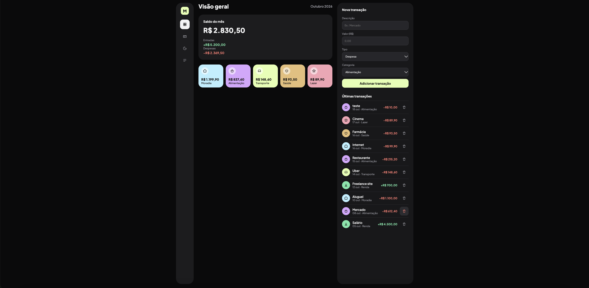

# MoneyFlow

Aplicativo de finanças pessoais feito com React. Registre entradas e despesas e acompanhe o saldo do mês.

## Funcionalidades

- Adicionar transações com descrição, valor, tipo (entrada ou despesa) e categoria
- Apagar transações
- Saldo, entradas e despesas calculados automaticamente
- Cards de gastos por categoria, calculados a partir da lista
- Dados salvos no navegador (localStorage), sem perder nada ao atualizar a página

## Tecnologias

- React
- Vite
- JavaScript
- CSS

## Como rodar o projeto

1. Instale as dependências: `npm install`
2. Rode o servidor: `npm run dev`
3. Abra `http://localhost:5173` no navegador

## O que aprendi

- Dividir a interface em componentes e passar dados com props
- Guardar dados com `useState` e salvar com `useEffect` e `localStorage`
- Gerar listas com `.map()` e calcular totais com `.filter()` e `.reduce()`
- Formulários controlados, com um estado para cada campo
- Avisar o componente pai com funções passadas por props
- Formatar dinheiro com `toLocaleString`

## Próximas melhorias

- Campo de data
- Filtros por tipo, categoria e mês
- Editar transações
- Gráficos
- Versão para celular
